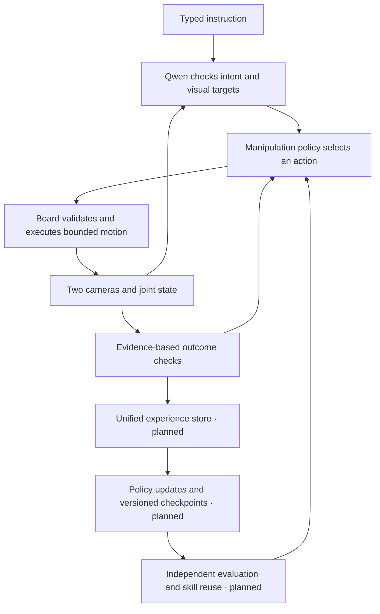

<h1 align="center">SO-101 Self-Learning</h1>

<p align="center">
  <strong>Real-world learning under vision-language supervision</strong><br>
  Help a robot build reusable manipulation skills from its own physical trials and failures.
</p>

<p align="center">
  <a href="LICENSE"></a>
  <a href="pyproject.toml"></a>
  <a href="https://github.com/gzcnb/so101-self-learning/actions/workflows/checks.yml"></a>
  <a href="docs/setup.md"></a>
  <a href="docs/setup.md"></a>
  <a href="docs/setup.md"></a>
</p>

<p align="center">
  <a href="README.md">中文</a> ·
  <a href="docs/self-learning.md">Learning design, Chinese</a> ·
  <a href="docs/results.md">Results</a> ·
  <a href="docs/setup.md">Setup</a> ·
  <a href="docs/roadmap.md">Roadmap</a>
</p>

The intended interaction is simple. Type “stack the orange block on the gray block” into a web console. The arm finds the objects, attempts the task, checks the outcome, and uses that experience to improve its next attempt. A later session should reuse the learned behavior, including when object positions change.

The target platform is an **SO-101 arm, Orange Pi 5 Max, and NVIDIA workstation**. The research goal is **learning on real hardware without human task demonstrations, with a vision-language model supervising task interpretation and outcome checks**.

> This is an experimental prototype. The release includes a dual-camera console, Qwen visual checks, geometric manipulation, recovery logic, online joint compensation, and numerical records. One swap arrangement passed a final image check after corrections and resumed execution. Reliable stacking, autonomous resets, and the complete task-policy learning loop remain open work.

## Why self-learning matters

Real manipulation depends on details of the particular arm and workspace. Loads change tracking error, visual localization is imperfect, blocks slip, and a fixed gripper finger can disturb an object after release. A language model can interpret the instruction while the arm still needs physical feedback about these details.

During this project's stacking experiments, the orange block sometimes remained briefly on the gray block and was then knocked down as the gripper withdrew. Repeated manual edits to release height and retreat paths make each new task depend on further engineering. The goal of self-learning is to turn these failures into experience that updates action selection and improves later attempts.

We want to reduce per-task teaching and tuning, adapt to hardware and workspace changes, and reuse learned grasping, release, and recovery behavior in longer tasks. Each benefit requires measurement. Progress means better success rates, completion times, and intervention counts under a fixed interaction budget, with improvements retained after restarting and tested on new layouts.

## How supervision and learning fit together

The intended loop is shown below. The unified experience store, task-policy trainer, and evaluated skill reuse are development work.



**Qwen provides visual and semantic supervision.** Current calls check the requested object pair and verify stacking outcomes. Future training feedback should link stage labels and failure descriptions to recorded observations. Visual localization, joint state, and images after withdrawal must support the outcome judgment. Ambiguous observations need an explicit unconfirmed state.

**A learner converts feedback into behavior changes.** The current RLS module updates joint-tracking compensation. The stacking workflow saves bounded placement corrections. The next step is a task policy that learns adjustments to grasping, release, and retreat from repeated physical interactions, saves model versions, and passes independent evaluation before adoption.

**Orange Pi enforces execution boundaries.** Model decisions and learned actions pass through board-side checks. The language model's text does not become arbitrary servo commands. Shared ownership and auditing across all hardware entry points remain a priority.

Qwen runs inference with existing weights. This repository does not fine-tune Qwen online. Learning currently occurs in compensation parameters, with task-policy updates still to be integrated.

## What zero demonstrations means

The target training protocol requires no leader-arm teleoperation or recorded successful action trajectory. The arm attempts actions within a constrained workspace and updates behavior from observed outcomes.

Calibration, pretrained visual-language knowledge, action limits, and a task success definition are still required. The current prototype also uses engineered stages and measured reference poses. Development included manual object resets and code adjustments. Evaluations must report demonstrations, resets, takeovers, and code changes separately.

Autonomous training also needs a reset policy. An accessible dropped block should be relocated and recovered when supported by observations. An unreachable object or uncertain scene should end the episode and record the need for intervention. This capability is incomplete.

## Current implementation

| Area | Available | Remaining work |
| --- | --- | --- |
| Interface | Typed Chinese commands for a limited task set, fixed and wrist camera previews | Broader task expressions and supervision records |
| VLM supervision | Target identity and stacking checks | Traceable stage feedback and failure labels for training |
| Swapping | Temporary placement, three transfers, placement checks, progress saving and resume, one recorded final arrangement | Repeated evaluation with all failures and interventions counted |
| Stacking | Grasp and support checks, placement correction, staged release and withdrawal | Reliable release and stability after parking |
| Parameter learning | Online RLS compensation, persistent bounded stacking corrections | Model save/load and measured benefits across episodes |
| Task-policy learning | Visual encoder and GRU definitions, aerial-motion records from a separate branch | Interaction data, training entry points, checkpoints, independent evaluation |
| Training infrastructure | Partial logs, progress checkpoints and bounded retries | Unified episodes, rewards, resets, ownership and scheduling |

Current manipulation relies primarily on geometry, measured reference poses, and feedback corrections. The task-policy learning loop is incomplete. DreamerV3 training is not integrated. See [recorded results and limitations](docs/results.md).

## Evidence required for a learning claim

1. Trace physical observations, actions, and outcomes to an actual parameter or policy update.
2. Save the learned model, restart the system, and reuse it.
3. Freeze the policy and compare it against the frozen initial controller on layouts excluded from training.
4. Report successes, total attempts, physical interaction time, recovery attempts, manual resets, and takeovers.
5. Invoke the skill again from an instruction, with fresh localization and outcome checks in a new reachable layout.

## Offline quick start

Install [uv](https://docs.astral.sh/uv/) and run the following commands.

```sh
uv sync --python 3.12 --frozen
uv run python scripts/offline_demo.py
uv run python scripts/check_release.py
uv run python -m unittest discover -s workbench -p 'test_*.py' -v
```

The demo uses a synthetic constant joint disturbance to illustrate RLS updates. Its output describes that synthetic system. Hardware performance requires separate measurement.

## Web console and hardware

```sh
uv run python workbench/swap_console.py
```

Open `http://127.0.0.1:8765/`. The interface can start without hardware. Camera access requires Orange Pi configuration. Motion requires a locally reviewed calibration profile and explicit opt-in.

Supported examples include the following Chinese instructions.

```text
把橙色和带圆纹的深灰色方块互换
继续上次换位
把橙色方块叠放在灰色方块上面
```

The workstation runs the UI, Qwen visual checks, and planning, and is intended to host policy training. Orange Pi connects cameras and servos and runs board-side control. Commands and results use SSH/SFTP. The web console binds to loopback by default.

Follow [setup and calibration](docs/setup.md) to create your own profile and local settings. The numeric samples in `examples/reference-profile/` describe the original experiment. Workspace bounds and some poses still require adaptation to each installation.

## Contributing

The priority is a complete path from physical experience to reusable skills.

| Task | Deliverable |
| --- | --- |
| [#1 Experience-driven policy learning](https://github.com/gzcnb/so101-self-learning/issues/1) | Runnable interaction, training, persistence, resume and frozen-policy evaluation |
| [#2 Stable stacking and recovery](https://github.com/gzcnb/so101-self-learning/issues/2) | Stability after release and withdrawal, classified failures and recovery decisions |
| [#3 Controller ownership and audit](https://github.com/gzcnb/so101-self-learning/issues/3) | Shared ownership across hardware entry points and traceable actions |
| [#4 Visual-policy reproduction](https://github.com/gzcnb/so101-self-learning/issues/4) | Licensed data, training commands, weights and independent hardware evaluation |

The [roadmap](docs/roadmap.md) describes dependencies and acceptance criteria. Contributions should state priors, human involvement, data provenance, evaluation methods, and failures.

## Source and licensing

`workbench/` contains the interface, supervision, planning and board control. `learning/rls.py` provides joint compensation. `learning/visual_policy.py` provides optional CNN and GRU definitions and a servo guard, requiring `uv sync --extra policy`. `scripts/` contains offline examples and release checks. `evidence/` contains numerical results and failure summaries.

Code is licensed under Apache-2.0. SO-101 geometry comes from TheRobotStudio/SO-ARM100 with attribution in NOTICE and [provenance](docs/provenance.md). LeRobot, llama.cpp, and external model weights retain their own licenses. Qwen weights are supplied separately. See [related work](docs/related-projects.md) for other robotics learning and SO-101 projects.
