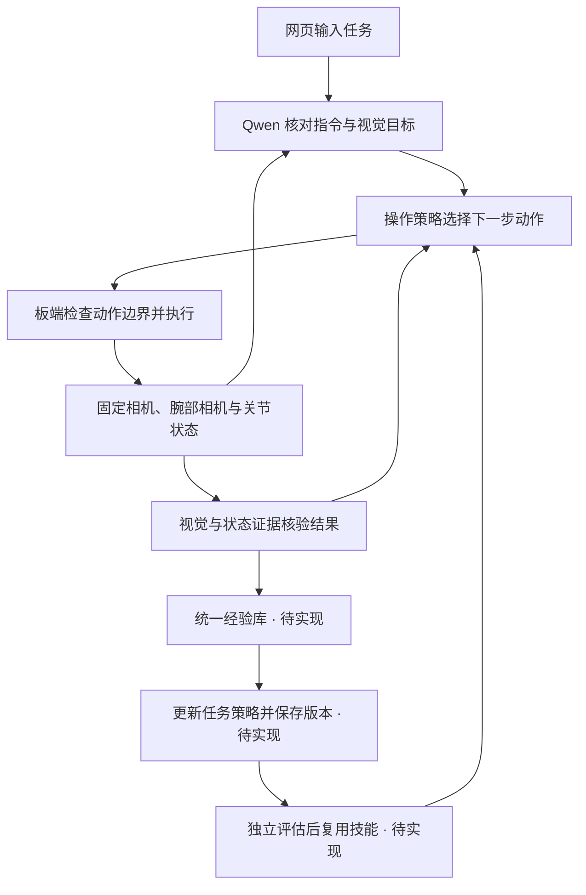

<h1 align="center">SO-101 Self-Learning</h1>

<p align="center">
  <strong>大模型监督下的真机自主学习</strong><br>
  让机械臂从自己的真实试错中积累经验，逐步学会完成一句话交代的任务。
</p>

<p align="center">
  <a href="LICENSE"></a>
  <a href="pyproject.toml"></a>
  <a href="https://github.com/gzcnb/so101-self-learning/actions/workflows/checks.yml"></a>
  <a href="docs/setup.md"></a>
  <a href="docs/setup.md"></a>
  <a href="docs/setup.md"></a>
</p>

<p align="center">
  <a href="README.en.md">English</a> ·
  <a href="docs/self-learning.md">自学习设计</a> ·
  <a href="docs/results.md">实测与局限</a> ·
  <a href="docs/setup.md">安装与标定</a> ·
  <a href="docs/roadmap.md">参与开发</a>
</p>

你在网页输入“把橙色方块叠在灰色方块上”。机械臂通过相机找到目标，尝试抓取和叠放，检查结果，再利用本次经验改进下一次动作。下一次换了物块位置，或重新启动系统，它应当能继续使用已经学到的能力。

这是本项目要实现的目标。硬件采用 **SO-101 + Orange Pi 5 Max + NVIDIA 电脑**，研究重点是 **大模型监督下、零人工任务示范的真机自主学习**。

> 当前为实验原型。已发布双相机网页、Qwen 视觉核验、几何操作流程、失败恢复、在线关节补偿及数值记录。一次换位在多次修正和断点续跑后通过终态复拍。稳定叠放、自动重置和任务策略的完整自主学习闭环仍待实现。

## 为什么自学习是这个项目的核心

机械臂进入真实桌面后，会遇到很具体的问题。同样的关节指令在不同负载下有偏差，相机定位有误差，方块会滑动，夹爪松开后仍可能碰到物体。语言模型能够理解“叠放”，这些细节还需要这台机械臂在自己的工位上获得反馈。

本项目已经遇到过这样的失败。橙块短暂留在灰块上，机械臂退出时，固定爪又把橙块带落。如果每次失败都需要人修改高度、角度和退出路径，新增任务仍会不断增加人工调试工作。**自学习要让这些失败成为可再次利用的经验，让系统能自行更新动作选择，并在后续任务中保留改进。**

我们希望这种能力带来三项实际价值。

- **减少逐个任务的人工教学和调参。** 在定义好任务目标和探索边界后，由机械臂收集自己的成功与失败，学习抓取、放置和退出时的调整。
- **适应真实硬件与环境的变化。** 用实际观察修正负载、装配和物体位置带来的偏差，检验旧经验在哪些条件下仍然有效。
- **让操作能力可以积累和复用。** 已学到的抓取、释放和恢复能力，应能帮助后续换位、叠放等组合任务。它们的收益需要通过实验逐项验证。

项目是否取得进展，要看相同试错预算下，后续成功率、完成时间和人工介入次数有没有改善，以及这些改善能否在重启和新布局后保留。

## 大模型怎样监督，机械臂怎样学习

系统分开处理任务含义、物理执行和经验更新。下图是目标闭环，标为“待实现”的部分是开放开发任务。



**Qwen 负责视觉和语义监督。** 当前代码用它核对指令对应的两块物体，并复核叠放结果。后续需要将阶段进展和失败证据整理成训练反馈。模型的判断要与图像定位、关节状态和退出后的复拍交叉检查，遮挡或证据不足时保留“无法确认”。

**学习器负责把反馈变成动作改进。** 当前 RLS 会更新关节跟踪补偿，叠放流程会保存有限的落点修正。下一步要让任务策略从多次真实交互中学习抓取偏移、释放条件和退出动作，保存策略版本，并通过独立评估决定是否采用。

**Orange Pi 负责执行边界。** 大模型提出的判断与后续学习器产生的动作，都需要经过板端控制检查。模型的文字输出不会直接变成任意舵机指令。统一所有控制入口的控制权与审计仍是优先开发项。

Qwen 使用已有权重进行推理，本仓库没有在线微调 Qwen。机械臂的学习发生在补偿参数以及计划接入的动作策略中。详细的数据流、监督职责和训练路线见 [自学习设计](docs/self-learning.md)。

## 零人工示范的范围

目标训练过程中，操作者无需使用主从臂遥操作，也无需录制“正确抓取一次”的动作轨迹。机械臂在受限工作区内自己尝试，根据结果更新策略。

这仍然需要硬件标定、预训练视觉语言模型、动作范围和任务成功判据。当前原型还依赖人工编排的操作阶段、实测参考姿态，并在开发中使用过人工摆回物体。后续评估会分别记录示范、重置、接管和代码修改，公开这些依赖。

完整的自主训练还要解决失败后的重置。方块仍在可达范围内时，需要自主重新定位和恢复。物块落出工作区或现场状态不明时，系统应结束本轮并记录介入需求。当前尚未完成这一能力。

## 现在已经做到哪里

| 部分 | 当前实现与证据 | 下一步 |
| --- | --- | --- |
| 文字与视觉入口 | 网页输入有限范围的中文指令，固定和腕部相机预览 | 扩展任务表达并保留监督证据 |
| 大模型监督 | Qwen 核对目标身份、复核叠放结果 | 为训练提供可追溯的阶段标签和失败反馈 |
| 方块换位 | 暂放点选择、三段搬运、落点核验、保存进度与续跑，保留一次终态通过记录 | 固定协议下连续测试，统计全部失败与介入 |
| 方块叠放 | 抓取核验、底座复核、落点修正、分段松爪与退出流程 | 解决滑落和固定爪带落，完成退回后的稳定验收 |
| 在线参数学习 | RLS 更新关节补偿，叠放偏差保存到本地文件 | 补齐模型保存与恢复，验证跨回合收益和适用范围 |
| 任务策略学习 | 已有视觉编码器、GRU 策略定义和另一分支的空中运动记录 | 发布真实交互数据、训练入口、策略权重和独立评估 |
| 自主训练基础设施 | 有局部日志、进度保存与受限重试 | 统一经验格式、奖励、重置、控制权和训练调度 |

当前操作流程主要由几何规划、实测参考姿态和反馈修正组成。完整的任务策略自学习尚待接通。仓库未集成 DreamerV3 训练器。

[实测与局限](docs/results.md) 列出了成功证据、失败记录及其能支持的结论。我们会持续保留失败样本，并将训练数据与最终评估数据分开。

## 如何证明它学到了

开放任务的验收围绕以下证据展开。

1. **经验改变了模型。** 能追溯某次真实尝试的观测、动作、结果，及其参与更新后的参数或策略版本。
2. **改进能被保留。** 重启后加载已保存的模型，在相同任务条件下继续使用。
3. **改进经得起独立测试。** 冻结策略，在未用于更新的物块布局上，与冻结的初始控制器比较。
4. **代价被完整统计。** 公布成功数、尝试总数、真实交互时间、恢复次数、人工重置与接管次数。
5. **技能可以再次调用。** 相同指令在新的可达布局中重新识别目标、执行和核验，失败时执行有证据支持的恢复。

## 无硬件体验

安装 [uv](https://docs.astral.sh/uv/) 后运行。

```sh
uv sync --python 3.12 --frozen
uv run python scripts/offline_demo.py
uv run python scripts/check_release.py
uv run python -m unittest discover -s workbench -p 'test_*.py' -v
```

示例使用合成的恒定关节扰动，演示 RLS 如何根据误差更新补偿。输出反映该合成系统中的变化。真机表现需要单独测量。

## 网页与硬件接入

```sh
uv run python workbench/swap_console.py
```

打开 `http://127.0.0.1:8765/`。默认可查看界面，相机需要配置 Orange Pi，机械臂动作需要完成本机标定并显式启用。

当前支持的指令示例。

```text
把橙色和带圆纹的深灰色方块互换
继续上次换位
把橙色方块叠放在灰色方块上面
```

桌面电脑运行网页、Qwen 视觉监督与规划，后续承担策略训练。Orange Pi 连接双相机与舵机，执行板端控制。两者通过 SSH/SFTP 交换命令与结果，网页默认绑定本机回环地址。

按照 [安装与标定](docs/setup.md) 创建自己的 profile 和本地配置。`examples/reference-profile/` 保留原实验的数值样本，真实动作需要使用自己的标定。原型中的工作区与部分姿态仍需按工位调整。

## 参与开发

我们优先补齐从试错经验到可复用技能的链路。

| 任务 | 需要交付的结果 |
| --- | --- |
| [#1 真实经验驱动的策略更新](https://github.com/gzcnb/so101-self-learning/issues/1) | 可运行的交互、训练、保存、恢复与冻结评估闭环 |
| [#2 稳定叠放与恢复](https://github.com/gzcnb/so101-self-learning/issues/2) | 松爪和退回后仍稳定，失败可分类并判断能否重试 |
| [#3 控制权与动作审计](https://github.com/gzcnb/so101-self-learning/issues/3) | 所有执行入口共享控制权，每次动作可追溯 |
| [#4 视觉策略复现](https://github.com/gzcnb/so101-self-learning/issues/4) | 数据许可、训练命令、策略权重与独立实机评估 |

[开发路线](docs/roadmap.md) 说明任务依赖和阶段验收。贡献时请注明使用的先验、人工介入和数据来源，并同时提交失败记录与评估方法。

## 仓库结构与许可

- `workbench/` 包含网页、视觉监督、几何规划与板端执行。
- `learning/rls.py` 包含在线关节补偿器。
- `learning/visual_policy.py` 包含可选的 CNN 视觉编码器、GRU 策略和关节保护器，需要 `uv sync --extra policy`。
- `scripts/` 包含离线示例、profile 准备工具和发布检查。
- `evidence/` 保留数值结果与失败摘要，来源见 [记录说明](docs/provenance.md)。

代码按 Apache-2.0 发布。SO-101 URDF 和网格来自 TheRobotStudio/SO-ARM100，版本及归属见 [来源说明](docs/provenance.md)。LeRobot、llama.cpp 与外部模型权重遵循各自许可证，Qwen 权重需自行准备。

相关的机器人学习框架、SO-101 实验和视觉控制项目见 [相关工作](docs/related-projects.md)。
